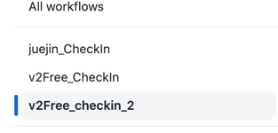
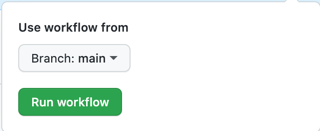

## 定时任务脚本

执行结束发送邮件通知签到结果。

使用方法：fork 本仓库

打开浏览器，登陆对应网站，F12 查看 Network 面板，复制 cookie

打开 github 仓库的 Setting，选择 Secrets，按下面的名字新建仓库 Secret（区分大小写，需与 workflow 中一致）

| key | value |
|-------------|------------------------|
| juejin_COOKIE | 掘金账号 1 的 cookie |
| juejin_COOKIE2 | 掘金账号 2 的 cookie |
| v2Free_COOKIE | v2free 账号 1 的 cookie |
| v2Free_COOKIE_2 | v2free 账号 2 的 cookie |
| USER | 发送邮件的邮箱地址，该邮箱需要开启 SMTP |
| PASS | 该邮箱的 SMTP 密码 |
| TO | 接收邮件的邮箱 |

脚本从环境变量读取这些值。本地调试也可以走命令行：

```bash
node src/juejin.js "<cookie>" "<USER>" "<PASS>" "<TO>"
node src/v2Free.js "<cookie>" "<USER>" "<PASS>" "<TO>"
```

定时为每天北京时间 05:30（UTC 21:30）。


之后进入Actions中，找到对应的名称的脚本文件




点击按钮
Run workflow



选择一个分支，然后点击绿色按钮`Run workflow`直接执行就OK了

